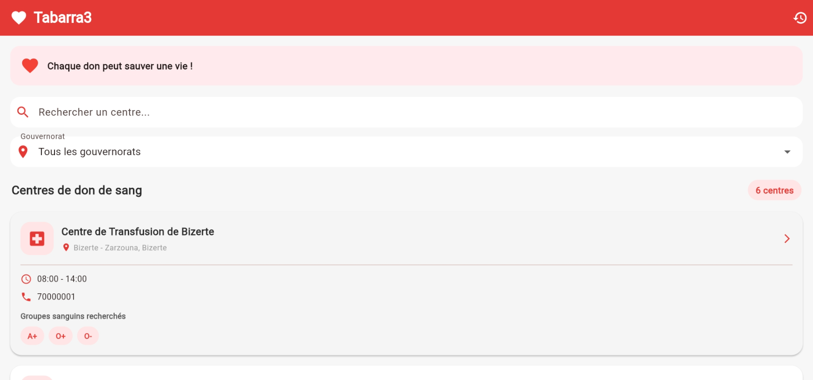
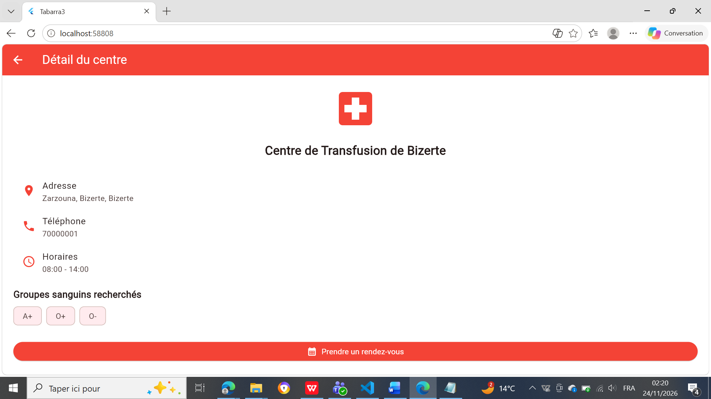
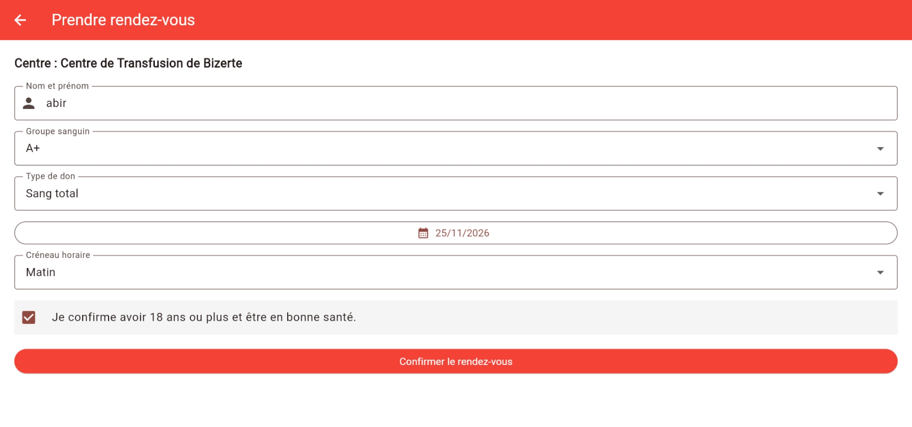
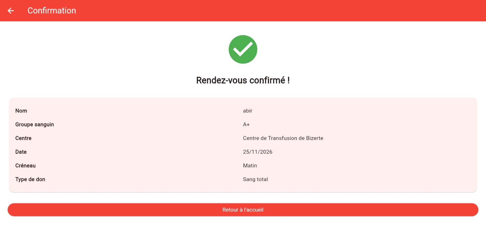
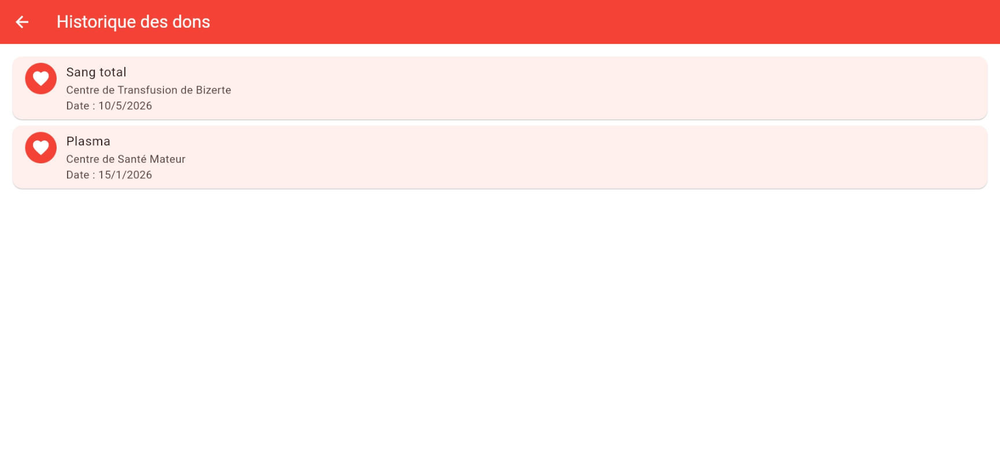

# Tabar3 – Application de dons

## 1. Présentation du projet

Tabar3 est une application mobile développée avec Flutter. Elle a pour objectif de faciliter les dons et de mettre en relation les donateurs avec les centres bénéficiaires.

L'application permet aux utilisateurs de consulter les centres, découvrir leurs informations et prendre des rendez-vous pour effectuer des dons.

## 2. Objectifs du projet

- Faciliter le processus de don.
- Mettre en relation les donateurs avec les centres bénéficiaires.
- Simplifier la prise de rendez-vous.
- Permettre le suivi des rendez-vous et des dons.

## 3. Jalon J1 – Le squelette

Le Jalon J1 consiste à mettre en place la structure générale de l'application, créer les interfaces principales et assurer la navigation entre les différents écrans.

### 3.1. Écrans de l'application

L'application contient cinq écrans principaux :

- **Accueil :** affichage de la liste des centres bénéficiaires.
- **Détail Centre :** affichage des informations détaillées d'un centre.
- **Rendez-vous :** formulaire permettant de préparer un rendez-vous.
- **Confirmation :** affichage de la confirmation du rendez-vous.
- **Historique :** consultation de l'historique des rendez-vous.

### 3.2. Navigation entre les écrans

Le parcours principal de navigation est le suivant :

**Accueil → Détail Centre → Rendez-vous → Confirmation → Historique**

### 3.3. Structure du projet

Le projet est organisé en plusieurs dossiers :

- `lib/models/` : contient les modèles de données.
- `lib/data/` : contient les données fictives utilisées dans l'application.
- `lib/screens/` : contient les différents écrans de l'application.
- `lib/screenshots/` : contient les captures d'écran des interfaces.

### 3.4. Technologies utilisées

- **Flutter :** développement de l'application mobile.
- **Dart :** langage de programmation.
- **Material Design :** conception des interfaces graphiques.
- **Git :** gestion des versions du projet.
- **GitHub :** hébergement du code source.

### 3.5. Données utilisées

Pour le Jalon J1, les données utilisées sont fictives et définies localement dans le projet. Elles permettent de présenter le fonctionnement général de l'application avant l'intégration d'une base de données réelle.

### 3.6. Répartition du travail

Projet réalisé individuellement.

## 4. Captures d'écran de l'application

### 4.1. Écran Accueil

### 4.2. Écran Détail Centre

### 4.3. Écran Rendez-vous

### 4.4. Écran Confirmation

### 4.5. Écran Historique

## 5. État d'avancement

Le Jalon J1 a pour objectif de réaliser le squelette de l'application Tabar3, de préparer les différents écrans et de mettre en place la navigation entre les interfaces.

Les prochaines étapes permettront d'améliorer les fonctionnalités et d'intégrer progressivement les données réelles.

---

**Projet : Tabar3**

**Jalon : J1 – Le squelette**

**Technologie principale : Flutter**